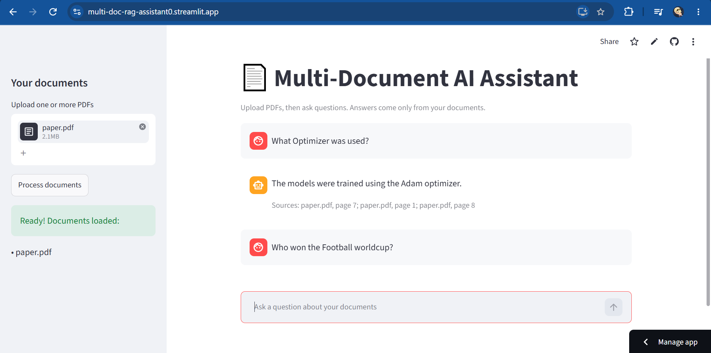

# 📄 Multi-Document AI Assistant (RAG)

Upload your own PDFs and ask questions about them in plain language. The assistant answers **only from your documents**, shows which file and page each answer came from, and says so when the answer isn't there.

**🔗 Live demo:** https://multi-doc-rag-assistant0.streamlit.app/



## Features

- Upload several PDFs and chat with them like in ChatGPT
- **Grounded answers:** the model is told to use only the retrieved text, and replies "I couldn't find that in the document." otherwise
- **Expandable citations:** every answer lists its sources and can show the exact passages it was given
- **Conversation memory:** follow-up questions such as "What about the learning rate?" are rewritten into standalone questions before searching
- **File filter:** choose which uploaded documents to search
- **Summarize button:** a map-reduce summary of each document (about 5 minutes per paper on the free API tier)
- Friendly messages when the free API limit is reached

## How it works

**Indexing** (when you click "Process documents")
1. `PyPDFLoader` extracts the text of each page, and the text is normalised (for example "fi" ligatures become "fi")
2. `RecursiveCharacterTextSplitter` cuts it into chunks of about 1000 characters with a 200-character overlap
3. An embedding model turns each chunk into a vector, stored in ChromaDB with its file name and page
4. A BM25 keyword index is built from the same chunks

**Answering** (each question)
1. If there is chat history, the LLM rewrites the follow-up into a standalone question
2. **Hybrid search:** dense (meaning) search and BM25 (keyword) search each return 20 candidates, merged with Reciprocal Rank Fusion
3. A **cross-encoder re-ranker** re-orders the candidates and keeps the best 3
4. The LLM answers from those 3 chunks only, and the app shows the answer with its sources

## Tech stack

| Part | Tool |
|---|---|
| Language | Python |
| RAG framework | LangChain |
| Embeddings | BAAI/bge-small-en-v1.5 (HuggingFace, runs locally) |
| Keyword search | BM25 (rank-bm25) |
| Re-ranker | cross-encoder/ms-marco-MiniLM-L-6-v2 |
| Vector database | ChromaDB |
| LLM | openai/gpt-oss-120b via the Groq API |
| Frontend | Streamlit |
| Hosting | Streamlit Community Cloud |

## Evaluation

I tested the system on two papers (Attention Is All You Need and BERT), with questions whose answers I wrote down from the PDFs. The test set is small, so one question is worth about 5 percentage points, and the results are a guide, not a benchmark.

### 1. Choosing the embedding model

My first model (`all-MiniLM-L6-v2`) worked on one paper and failed on the second: for "What does BERT stand for?" the chunk with the answer ranked 14th. I compared three models by the rank of the answer chunk:

| Model | "What does BERT stand for?" | "On how many NLP tasks...?" |
|---|---|---|
| all-MiniLM-L6-v2 | rank 14 | not in top 20 |
| **BAAI/bge-small-en-v1.5** | **rank 1** | **rank 2** |
| all-mpnet-base-v2 | not in top 20 | rank 6 |

A bigger model was not better here, so retrieval needs to be measured, not assumed.

### 2. Retrieval: does the right chunk come back? (19 questions)

| Method | Answer chunk ranked 1st | In the top 3 | MRR |
|---|---|---|---|
| Dense only (original) | 11/19 (58%) | 12/19 (63%) | 0.665 |
| BM25 only | 9/19 (47%) | 14/19 (74%) | 0.629 |
| Hybrid (dense + BM25 with RRF) | 11/19 (58%) | 16/19 (84%) | 0.714 |
| Dense + re-rank | 16/19 (84%) | 17/19 (89%) | 0.886 |
| Hybrid + re-rank (used in the app) | 16/19 (84%) | 17/19 (89%) | 0.884 |

The cross-encoder gave the biggest gain. Hybrid search helped on its own, but once the re-ranker was added it made no measurable difference on this small test, because the correct chunk was already among the dense candidates. I kept it because keyword search protects against exact-term queries (such as clause numbers or product codes) on larger collections, which this test does not cover.

### 3. Answers: LLM-as-judge (20 answerable + 5 out-of-scope questions)

A second LLM call judges whether each answer is supported by the retrieved text (*faithfulness*) and addresses the question (*relevance*). Correctness is checked separately by looking for the expected fact in the answer.

| | Baseline (dense, top 3) | Hybrid + re-rank |
|---|---|---|
| Correct | 17/20 (85%) | 18/20 (90%) |
| Faithful (among answered) | 18/19 (95%) | 18/18 (100%) |
| Out-of-scope questions refused | 5/5 | 5/5 |

The baseline's problems were wrong, incomplete or unsupported answers (for example it reported the GLUE score as the MultiNLI accuracy, which the judge did not catch). The upgraded system gave no wrong answers, and its two misses were refusals ("I couldn't find that"), which is the safer way to fail.

**Caveats:** the judge is the same model as the answerer, the keyword check for correctness is crude, the embedding model was chosen using some of the same questions, and 20 questions is a small sample.

## Run it locally

```bash
git clone https://github.com/saad-codes07/Multi-Document-Rag-Assistant.git
cd Multi-Document-Rag-Assistant

python -m venv venv
source venv/bin/activate        # Windows: venv\Scripts\activate

pip install -r requirements.txt
```

Get a free API key from [console.groq.com](https://console.groq.com) and create a file named `.env` in the project folder:

```
GROQ_API_KEY=your_key_here
```

Then start the app:

```bash
streamlit run app.py
```

To rerun the evaluations, put two PDFs in a `data/` folder named `paper.pdf` and `bert.pdf` and run `python eval_retrieval.py` or `python eval_answers.py`.

## Project structure

```
├── app.py               # Streamlit web interface
├── rag/
│   ├── loader.py        # PDF loading, text cleaning, chunking
│   ├── vectorstore.py   # embeddings and ChromaDB
│   ├── hybrid.py        # BM25 + dense search with Reciprocal Rank Fusion
│   ├── rerank.py        # cross-encoder re-ranking
│   ├── chain.py         # question rewriting, prompt, LLM
│   └── summarize.py     # map-reduce summaries (rate-limit aware)
├── eval_set.py          # test questions with expected answers
├── eval_retrieval.py    # retrieval evaluation
├── eval_answers.py      # LLM-as-judge answer evaluation
├── compare_models.py    # embedding model comparison
├── ask.py               # terminal chat (needs PDFs in data/)
└── requirements.txt
```

## Limitations

- **Free API limits.** The Groq free tier allows about 8,000 tokens per minute for this model, so summarizing one paper takes about 5 minutes, and heavy use can show a "try again in a minute" message
- **Scanned PDFs** (images of text) are not supported. OCR would be needed
- Whole-document questions work poorly in chat, because only 3 chunks are retrieved. Use the Summarize button for those
- Tables and figures in PDFs are extracted poorly
- Retrieval can still miss the right chunk, and the assistant then says it could not find the answer
- Document text is sent to an external LLM service (Groq), so it is not suitable for confidential files

## Ideas for improvement

- Repair words split across lines by hyphenation, and test giving the model 5 chunks instead of 3
- OCR for scanned PDFs
- A larger evaluation set, including exact-identifier questions
- Support for Word and text files

## What I learned

- How RAG works end to end, and how to improve it with hybrid search, re-ranking, query rewriting and citations
- That retrieval and answer quality should be measured, and that a single metric (or an LLM judge) can miss real errors
- Working within free-tier API limits, and deploying a Python app without exposing API keys

---
Built by [Muhammad Saad Ashraf](https://www.linkedin.com/in/muhammad-saad-ashraf-ba9a8a282/) · [GitHub](https://github.com/saad-codes07)